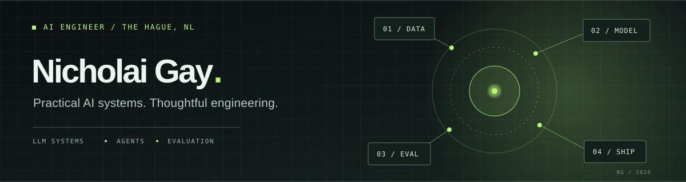

**AI Engineer · The Hague, Netherlands**

I build AI applications that connect models to the data, tools, and workflows people actually use. I care about grounded answers, measurable trade-offs, clear failure paths, and software that can move beyond a notebook.

My route into engineering began in operations and team leadership. That background keeps me focused on the real decision or service problem a system should solve. I’m curious by default, candid about limitations, and always learning.

**[Explore my portfolio ↗](https://profile.nickcloud.dev/)** &nbsp;·&nbsp; [LinkedIn](https://www.linkedin.com/in/nicholai-gay-201905148/) &nbsp;·&nbsp; [Email](mailto:nicholai.gay@gmail.com)

> **Open to AI engineering opportunities** with teams building useful, reliable AI in the Netherlands and across Europe.

## Selected work

| Project | Engineering focus |
| --- | --- |
| **[Infernomics](https://github.com/QinnniQ/infernomics)** | An LLM inference workbench comparing estimated cost, latency, caching, retrieval depth, and judged answer quality. Makes deployment trade-offs visible, with deterministic tests and a Streamlit dashboard. |
| **[Global Economic Intelligence Agent](https://github.com/QinnniQ/global-economic-intelligence-agent)** | Combines live World Bank indicators, PDF retrieval, and LLM synthesis in a FastAPI and Streamlit application. Includes inspectable evidence paths, Docker packaging, and CI. |
| **[Retail Support AgentOps](https://github.com/QinnniQ/rasa-retail-support-agent)** | A Rasa support prototype that checks *simulated* order data before giving guidance. Explicit fallback and human handoff paths keep the assistant within its limits. |
| **[Cloud Engineering API](https://github.com/QinnniQ/cloud-engineering-api)** | A live FastAPI service deployed on AWS EC2 with Docker, Nginx, HTTPS, and GitHub Actions, alongside a separate Terraform networking lab. **[View the live API ↗](https://api.nickcloud.dev/)** |

**Further experiments:** [ChipScope MCP](https://github.com/QinnniQ/chipscope-mcp) explores inspectable agent tools and paired evaluation. The [vision-language benchmark](https://github.com/QinnniQ/asml-vlm-prob-benchmark) examines uncertainty and calibration on synthetic semiconductor-style imagery.

## How I work

- **Ground the answer.** Connect models to relevant documents, structured data, or explicit tools, and make the evidence path inspectable.
- **Measure the trade-off.** Use baselines and evaluation to understand quality, latency, cost, and failure modes before making bigger claims.
- **Build the complete path.** Design the API, interface, tests, deployment, and handoff that make a prototype usable.

**Working across:** Python, FastAPI, RAG, LLM evaluation, MCP, Rasa, Hugging Face, Docker, AWS, Terraform, and CI/CD.

My background includes AI engineering training at Ironhack and over a decade of operations and management experience. I’m currently building conversational AI prototypes in a Rasa project collaboration.

---

**Want to talk about an AI engineering role or a problem worth solving?** [Visit my portfolio](https://profile.nickcloud.dev/) or [email me](mailto:nicholai.gay@gmail.com).
